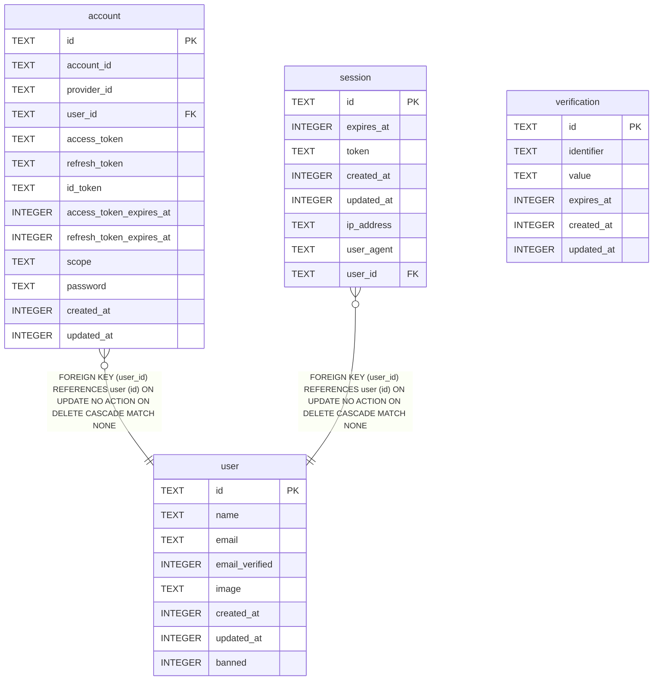

{/* Generated by bun run db:erd (product/packages/db/scripts/generate-erd.mjs) — do not edit. */}

Owned by `packages/db/src/auth.ts` (better-auth).

## ER diagram

Mermaid source: [`schema.mmd`](./schema.mmd)

## Tables

- [`account`](./tables/account.mdx)
- [`session`](./tables/session.mdx)
- [`user`](./tables/user.mdx)
- [`verification`](./tables/verification.mdx)
