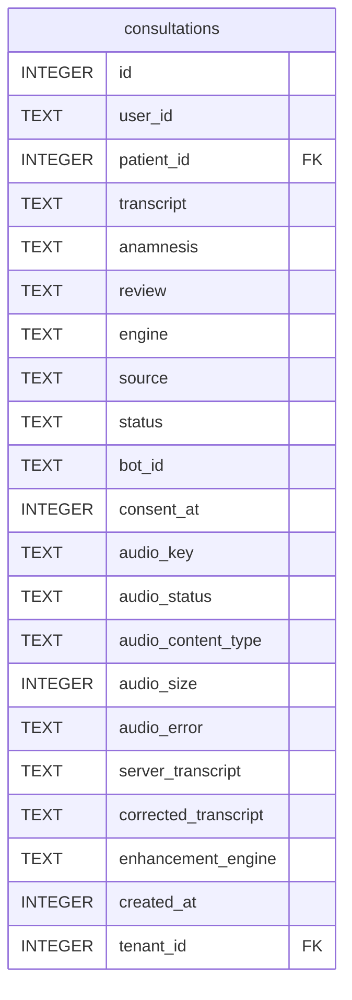

{/* Generated by bun run db:erd (product/packages/db/scripts/generate-erd.mjs) — do not edit. */}

Owned by `plugins/consultations`.

## ER diagram

## Tables

- [`consultations`](./consultations.mdx)
