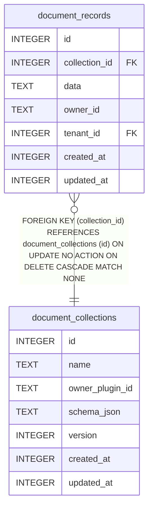

{/* Generated by bun run db:erd (product/packages/db/scripts/generate-erd.mjs) — do not edit. */}

Owned by `plugins/document-store`.

## ER diagram

Mermaid source: [`schema.mmd`](./schema.mmd)

## Tables

- [`document_collections`](/en/docs/developers/plugins/document-store/reference/tables/document_collections)
- [`document_records`](/en/docs/developers/plugins/document-store/reference/tables/document_records)
