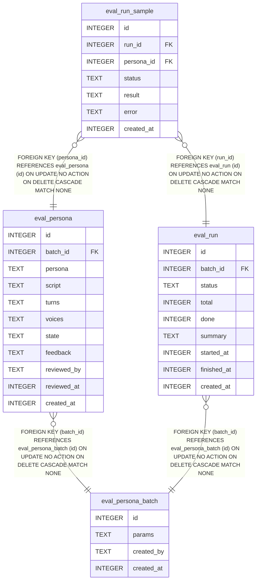

{/* Generated by bun run db:erd (product/packages/db/scripts/generate-erd.mjs) — do not edit. */}

Owned by `plugins/eval-validator`.

## ER diagram

Mermaid source: [`schema.mmd`](./schema.mmd)

## Tables

- [`eval_persona`](/en/docs/developers/plugins/eval-validator/reference/tables/eval_persona)
- [`eval_persona_batch`](/en/docs/developers/plugins/eval-validator/reference/tables/eval_persona_batch)
- [`eval_run`](/en/docs/developers/plugins/eval-validator/reference/tables/eval_run)
- [`eval_run_sample`](/en/docs/developers/plugins/eval-validator/reference/tables/eval_run_sample)
