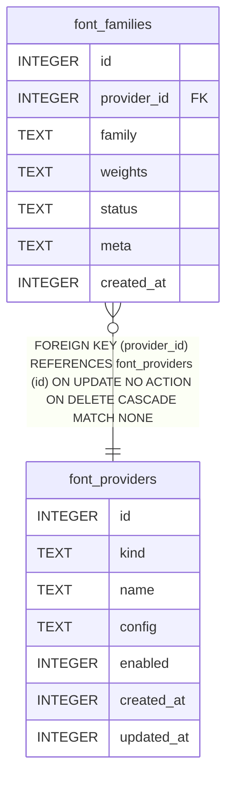

{/* Generated by bun run db:erd (product/packages/db/scripts/generate-erd.mjs) — do not edit. */}

Owned by `plugins/fonts`.

## ER diagram

Mermaid source: [`schema.mmd`](./schema.mmd)

## Tables

- [`font_families`](/en/docs/developers/plugins/fonts/reference/tables/font_families)
- [`font_providers`](/en/docs/developers/plugins/fonts/reference/tables/font_providers)
