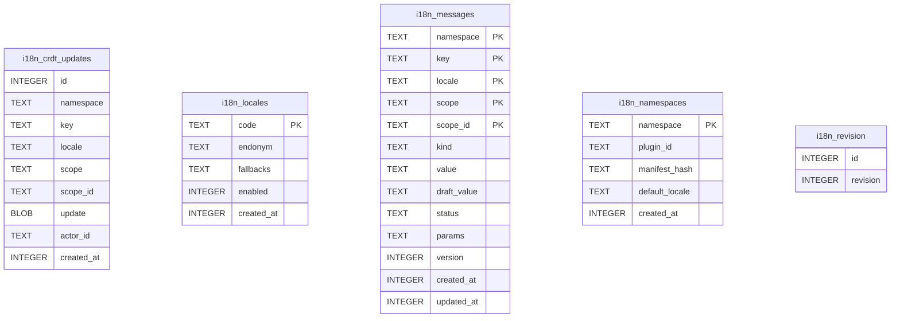

{/* Generated by bun run db:erd (product/packages/db/scripts/generate-erd.mjs) — do not edit. */}

Owned by `plugins/i18n` + `packages/i18n`.

## ER diagram

Mermaid source: [`schema.mmd`](./schema.mmd)

## Tables

- [`i18n_crdt_updates`](/en/docs/developers/plugins/i18n/reference/tables/i18n_crdt_updates)
- [`i18n_locales`](/en/docs/developers/plugins/i18n/reference/tables/i18n_locales)
- [`i18n_messages`](/en/docs/developers/plugins/i18n/reference/tables/i18n_messages)
- [`i18n_namespaces`](/en/docs/developers/plugins/i18n/reference/tables/i18n_namespaces)
- [`i18n_revision`](/en/docs/developers/plugins/i18n/reference/tables/i18n_revision)
