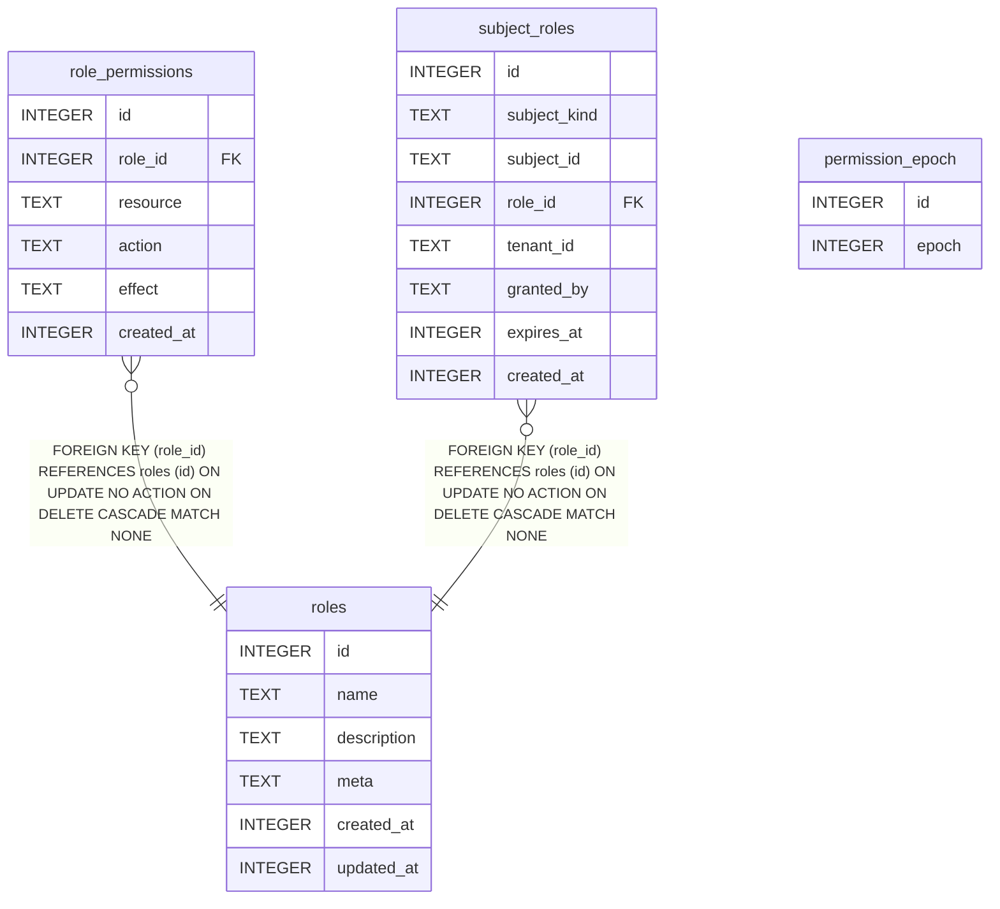

{/* Generated by bun run db:erd (product/packages/db/scripts/generate-erd.mjs) — do not edit. */}

Owned by `packages/rbac` + `plugins/rbac`.

## ER diagram

## Tables

- [`permission_epoch`](./permission_epoch.mdx)
- [`role_permissions`](./role_permissions.mdx)
- [`roles`](./roles.mdx)
- [`subject_roles`](./subject_roles.mdx)
