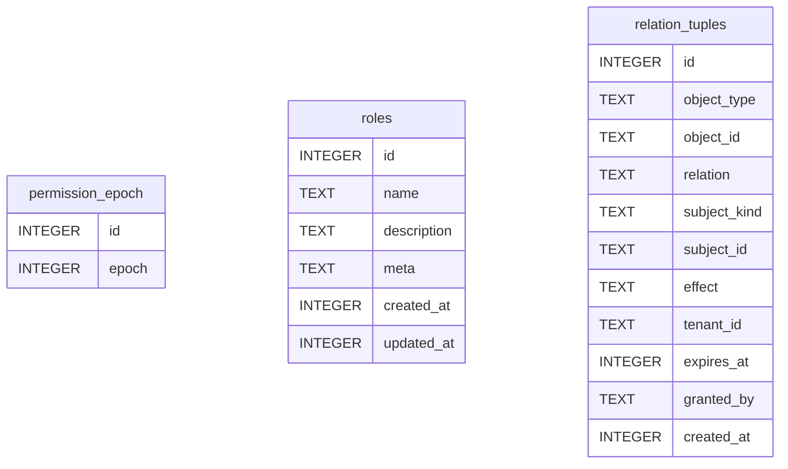

{/* Generated by bun run db:erd (product/packages/db/scripts/generate-erd.mjs) — do not edit. */}

Owned by `packages/rbac` + `plugins/rbac`.

## ER diagram

Mermaid source: [`schema.mmd`](./schema.mmd)

## Tables

- [`permission_epoch`](/en/docs/developers/plugins/rbac/reference/tables/permission_epoch)
- [`relation_tuples`](/en/docs/developers/plugins/rbac/reference/tables/relation_tuples)
- [`roles`](/en/docs/developers/plugins/rbac/reference/tables/roles)
