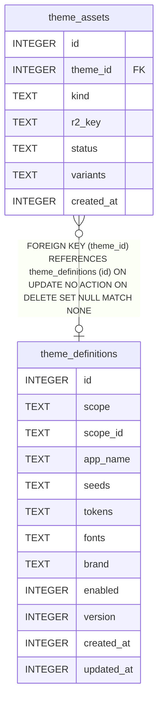

{/* Generated by bun run db:erd (product/packages/db/scripts/generate-erd.mjs) — do not edit. */}

Owned by `plugins/theme`.

## ER diagram

Mermaid source: [`schema.mmd`](./schema.mmd)

## Tables

- [`theme_assets`](/en/docs/developers/plugins/theme/reference/tables/theme_assets)
- [`theme_definitions`](/en/docs/developers/plugins/theme/reference/tables/theme_definitions)
