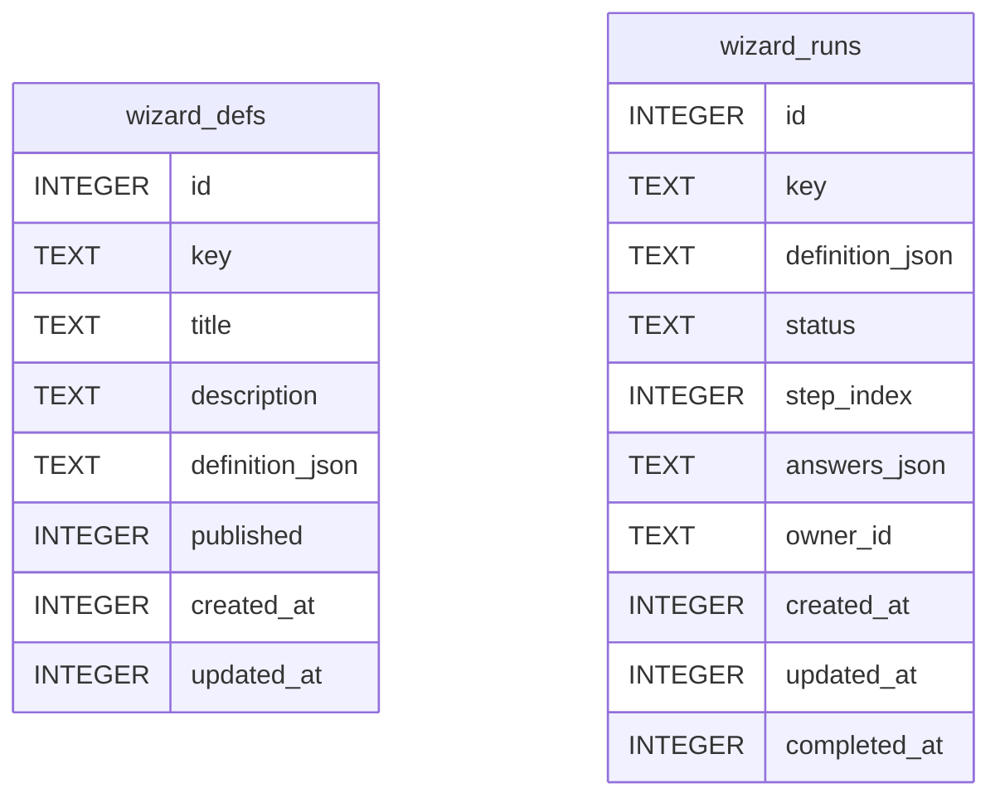

{/* Generated by bun run db:erd (product/packages/db/scripts/generate-erd.mjs) — do not edit. */}

Owned by `plugins/wizards`.

## ER diagram

Mermaid source: [`schema.mmd`](./schema.mmd)

## Tables

- [`wizard_defs`](/en/docs/developers/plugins/wizards/reference/tables/wizard_defs)
- [`wizard_runs`](/en/docs/developers/plugins/wizards/reference/tables/wizard_runs)
