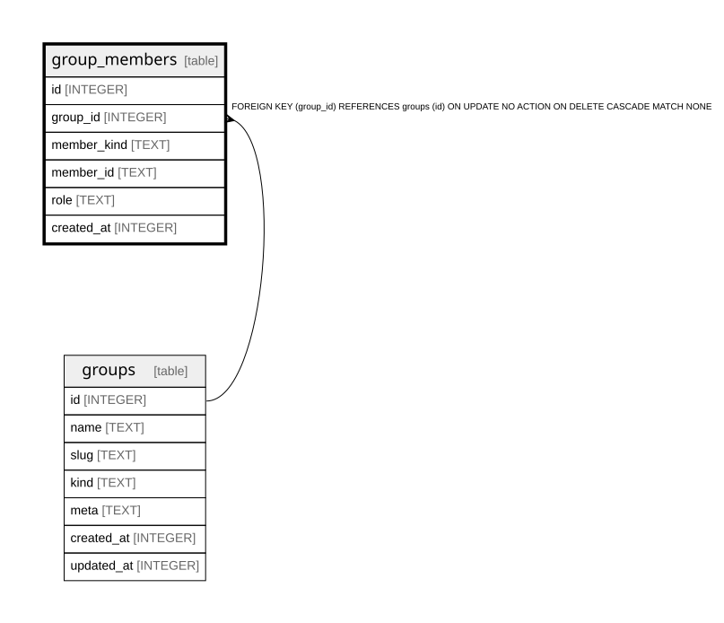

{/* Generated by bun run db:erd (product/packages/db/scripts/generate-erd.mjs) — do not edit. */}


## Description

<details>
<summary><strong>Table Definition</strong></summary>

```sql
CREATE TABLE `group_members` (
	`id` integer PRIMARY KEY AUTOINCREMENT NOT NULL,
	`group_id` integer NOT NULL,
	`member_kind` text NOT NULL,
	`member_id` text NOT NULL,
	`role` text,
	`created_at` integer DEFAULT (cast(unixepoch('subsecond') * 1000 as integer)) NOT NULL,
	FOREIGN KEY (`group_id`) REFERENCES `groups`(`id`) ON UPDATE no action ON DELETE cascade
)
```

</details>

## Columns

| Name | Type | Default | Nullable | Children | Parents | Comment |
| ---- | ---- | ------- | -------- | -------- | ------- | ------- |
| id | INTEGER |  | false |  |  |  |
| group_id | INTEGER |  | false |  | [groups](groups.md) |  |
| member_kind | TEXT |  | false |  |  |  |
| member_id | TEXT |  | false |  |  |  |
| role | TEXT |  | true |  |  |  |
| created_at | INTEGER | cast(unixepoch('subsecond') * 1000 as integer) | false |  |  |  |

## Constraints

| Name | Type | Definition |
| ---- | ---- | ---------- |
| id | PRIMARY KEY | PRIMARY KEY (id) |
| - (Foreign key ID: 0) | FOREIGN KEY | FOREIGN KEY (group_id) REFERENCES groups (id) ON UPDATE NO ACTION ON DELETE CASCADE MATCH NONE |

## Indexes

| Name | Definition |
| ---- | ---------- |
| group_members_group_member_idx | CREATE UNIQUE INDEX `group_members_group_member_idx` ON `group_members` (`group_id`,`member_kind`,`member_id`) |

## Relations



---

> Generated by [tbls](https://github.com/k1LoW/tbls)
