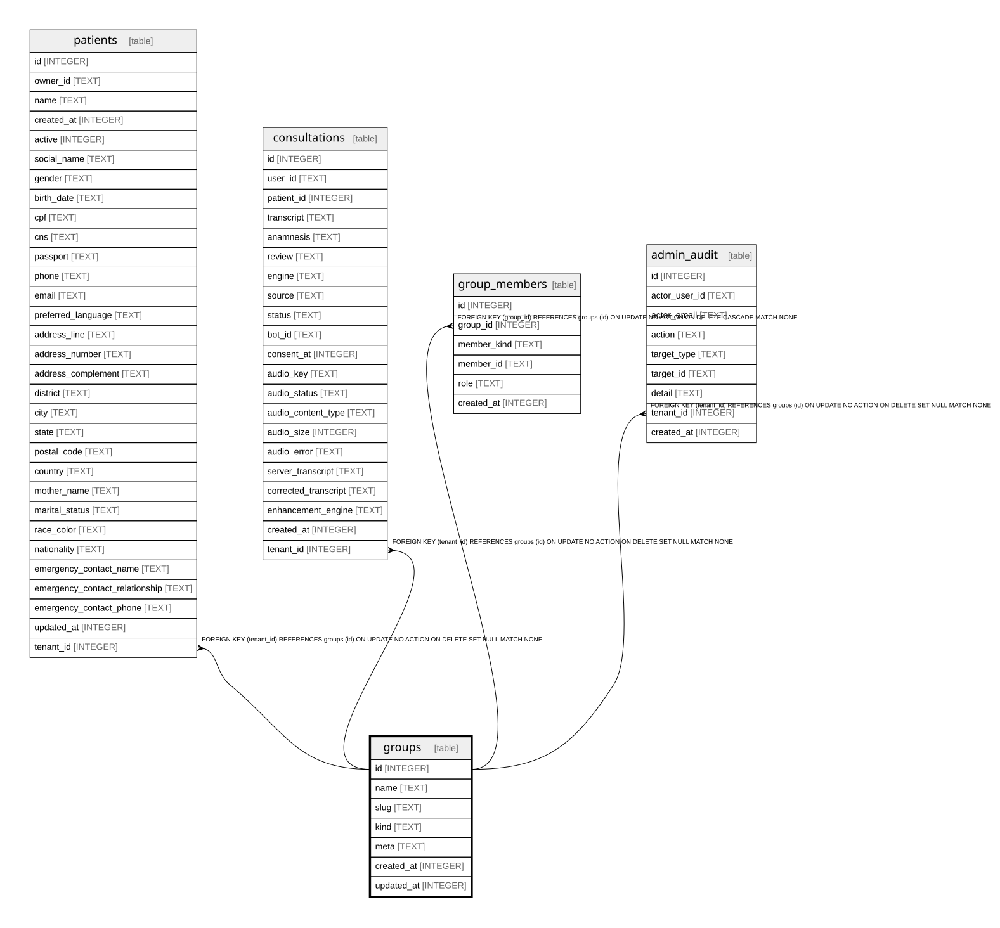

{/* Generated by bun run db:erd (product/packages/db/scripts/generate-erd.mjs) — do not edit. */}


## Description

<details>
<summary><strong>Table Definition</strong></summary>

```sql
CREATE TABLE `groups` (
	`id` integer PRIMARY KEY AUTOINCREMENT NOT NULL,
	`name` text NOT NULL,
	`slug` text NOT NULL,
	`kind` text NOT NULL,
	`meta` text,
	`created_at` integer DEFAULT (cast(unixepoch('subsecond') * 1000 as integer)) NOT NULL,
	`updated_at` integer DEFAULT (cast(unixepoch('subsecond') * 1000 as integer)) NOT NULL
)
```

</details>

## Columns

| Name | Type | Default | Nullable | Children | Parents | Comment |
| ---- | ---- | ------- | -------- | -------- | ------- | ------- |
| id | INTEGER |  | false | [patients](patients.md) [consultations](consultations.md) [group_members](group_members.md) [admin_audit](admin_audit.md) |  |  |
| name | TEXT |  | false |  |  |  |
| slug | TEXT |  | false |  |  |  |
| kind | TEXT |  | false |  |  |  |
| meta | TEXT |  | true |  |  |  |
| created_at | INTEGER | cast(unixepoch('subsecond') * 1000 as integer) | false |  |  |  |
| updated_at | INTEGER | cast(unixepoch('subsecond') * 1000 as integer) | false |  |  |  |

## Constraints

| Name | Type | Definition |
| ---- | ---- | ---------- |
| id | PRIMARY KEY | PRIMARY KEY (id) |

## Indexes

| Name | Definition |
| ---- | ---------- |
| groups_slug_unique | CREATE UNIQUE INDEX `groups_slug_unique` ON `groups` (`slug`) |

## Relations



---

> Generated by [tbls](https://github.com/k1LoW/tbls)
