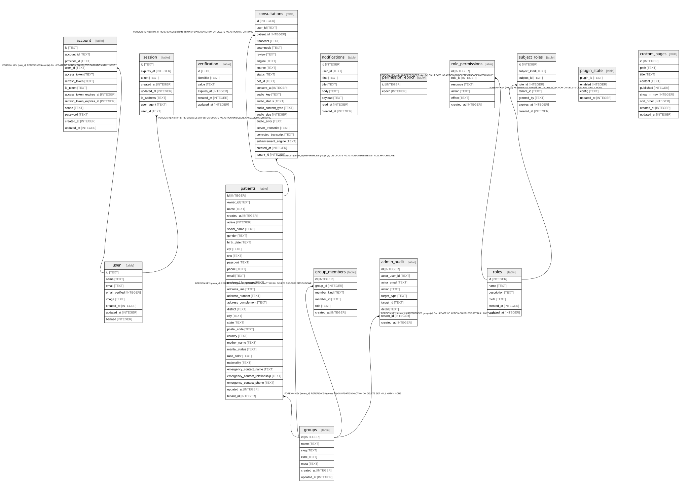
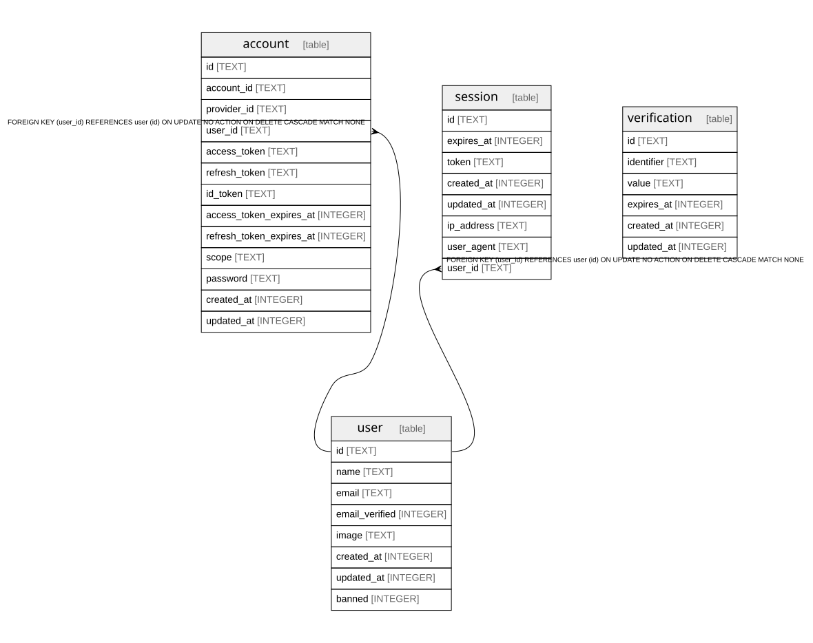
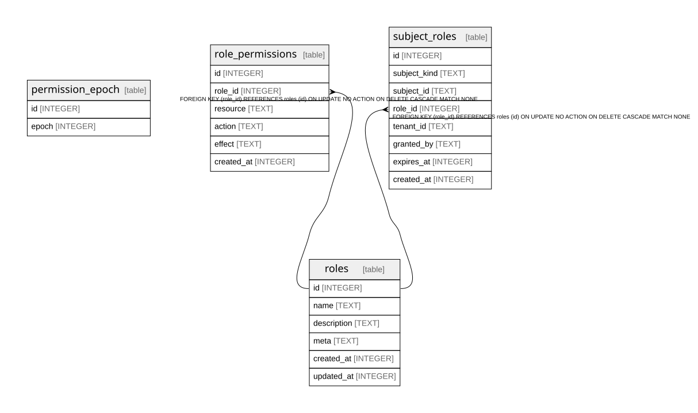
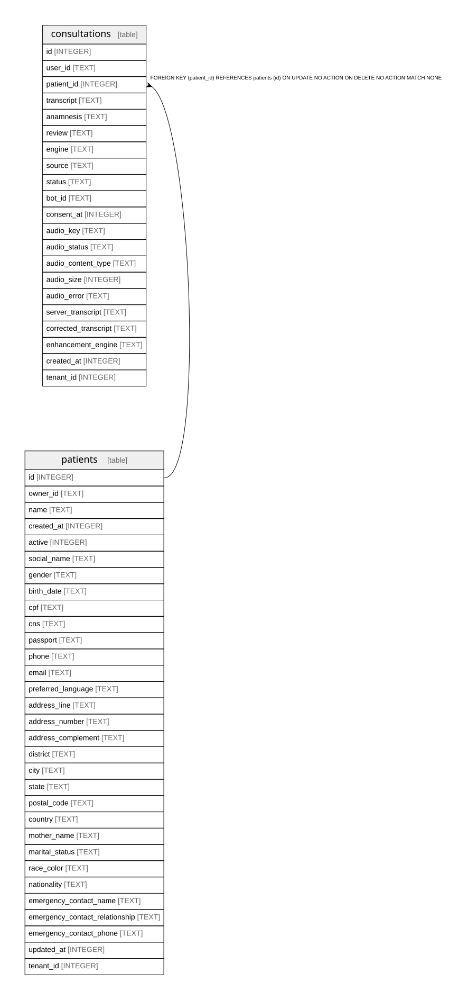
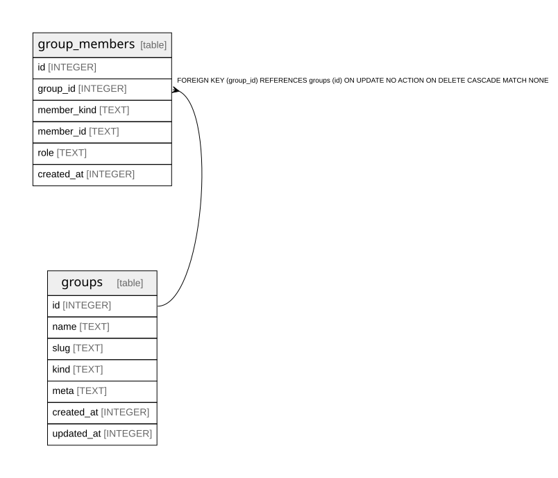
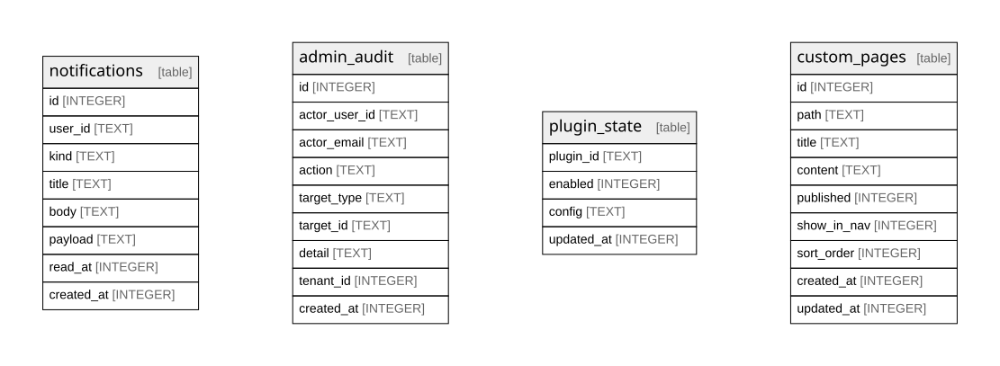
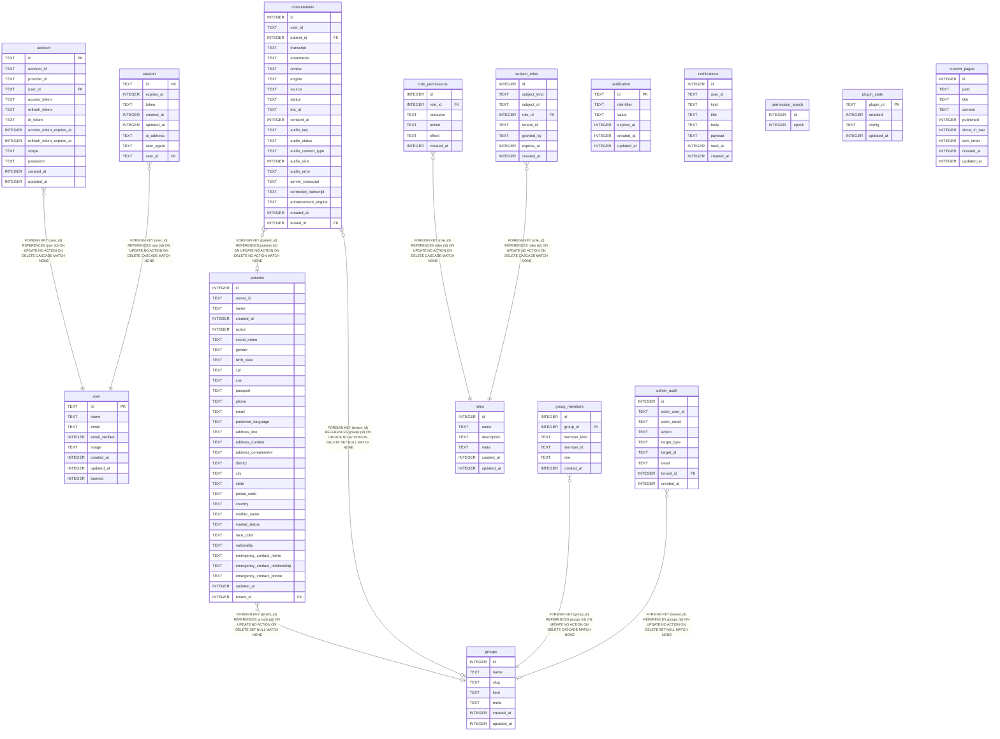

This section is **generated** from the Drizzle migrations in the `product`
repo (`packages/db/drizzle/*.sql`). Do not edit the files here by hand —
regenerate them instead.

## Regenerate

From the `product` repo root:

```bash
bun run db:erd
```

Requirements: `tbls` on `PATH` (or `TBLS_BIN` set). The script applies every
migration to a throwaway SQLite database and runs `tbls doc` + `tbls out`,
writing the results into `docs/content/docs/<locale>/developers/reference/database/`
for both `en` and `pt-BR`.

CI can verify the committed output is up to date without writing anything:

```bash
bun run db:erd --check
```

## What's here



- `schema.svg` — full entity-relationship diagram (all tables).
- `schema-<domain>.svg` — per-domain ER diagrams (see below).
- `schema.mmd` / `schema-<domain>.mmd` — the same diagrams as Mermaid
  `erDiagram` source; the full schema is also embedded below so it can be
  rendered once Mermaid support lands.
- `<table>.mdx` + `<table>.svg` — per-table column/index reference with a
  focused ER diagram.

## Domains

The schema is split along plugin/package boundaries:

### Auth

`user`, `session`, `account`, `verification` — better-auth
infrastructure (`packages/db`).



### RBAC

`roles`, `role_permissions`, `subject_roles`, `permission_epoch` —
roles, grants and the permission cache epoch (`packages/rbac` +
`plugins/rbac`).



### Clinical

`patients`, `consultations` — patient records and consultations
(`plugins/patients` + `plugins/consultations`).



### Groups

`groups`, `group_members` — patient cohorts and membership
(`plugins/groups`).



### Platform

`notifications`, `plugin_state`, `custom_pages`, `admin_audit` —
platform-owned runtime state, notifications, custom pages and the admin
audit log.



## Full schema (Mermaid)


