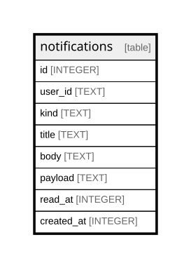

{/* Generated by bun run db:erd (product/packages/db/scripts/generate-erd.mjs) — do not edit. */}


## Description

<details>
<summary><strong>Table Definition</strong></summary>

```sql
CREATE TABLE `notifications` (
	`id` integer PRIMARY KEY AUTOINCREMENT NOT NULL,
	`user_id` text NOT NULL,
	`kind` text NOT NULL,
	`title` text NOT NULL,
	`body` text,
	`payload` text,
	`read_at` integer,
	`created_at` integer NOT NULL
)
```

</details>

## Columns

| Name | Type | Default | Nullable | Children | Parents | Comment |
| ---- | ---- | ------- | -------- | -------- | ------- | ------- |
| id | INTEGER |  | false |  |  |  |
| user_id | TEXT |  | false |  |  |  |
| kind | TEXT |  | false |  |  |  |
| title | TEXT |  | false |  |  |  |
| body | TEXT |  | true |  |  |  |
| payload | TEXT |  | true |  |  |  |
| read_at | INTEGER |  | true |  |  |  |
| created_at | INTEGER |  | false |  |  |  |

## Constraints

| Name | Type | Definition |
| ---- | ---- | ---------- |
| id | PRIMARY KEY | PRIMARY KEY (id) |

## Relations



---

> Generated by [tbls](https://github.com/k1LoW/tbls)
