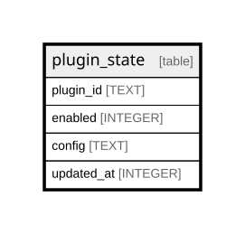

{/* Generated by bun run db:erd (product/packages/db/scripts/generate-erd.mjs) — do not edit. */}


## Description

<details>
<summary><strong>Table Definition</strong></summary>

```sql
CREATE TABLE `plugin_state` (
	`plugin_id` text PRIMARY KEY NOT NULL,
	`enabled` integer DEFAULT true NOT NULL,
	`config` text,
	`updated_at` integer NOT NULL
)
```

</details>

## Columns

| Name | Type | Default | Nullable | Children | Parents | Comment |
| ---- | ---- | ------- | -------- | -------- | ------- | ------- |
| plugin_id | TEXT |  | false |  |  |  |
| enabled | INTEGER | true | false |  |  |  |
| config | TEXT |  | true |  |  |  |
| updated_at | INTEGER |  | false |  |  |  |

## Constraints

| Name | Type | Definition |
| ---- | ---- | ---------- |
| plugin_id | PRIMARY KEY | PRIMARY KEY (plugin_id) |
| sqlite_autoindex_plugin_state_1 | PRIMARY KEY | PRIMARY KEY (plugin_id) |

## Indexes

| Name | Definition |
| ---- | ---------- |
| sqlite_autoindex_plugin_state_1 | PRIMARY KEY (plugin_id) |

## Relations



---

> Generated by [tbls](https://github.com/k1LoW/tbls)
