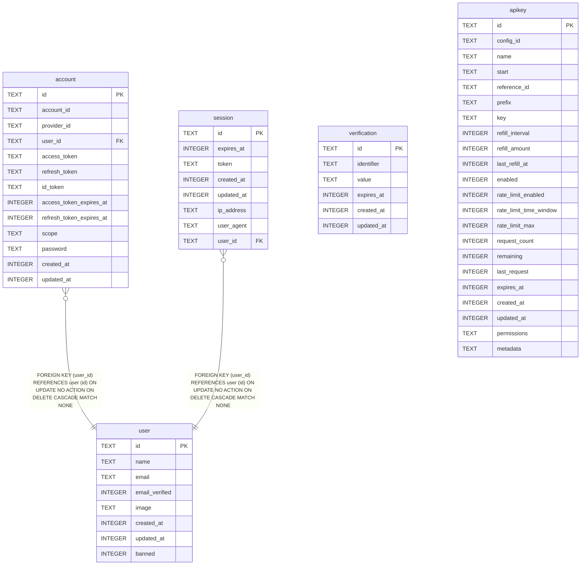

{/* Generated by bun run db:erd (product/packages/db/scripts/generate-erd.mjs) — do not edit. */}

Owned by `packages/db/src/auth.ts` (better-auth).

## ER diagram

Mermaid source: [`schema.mmd`](./schema.mmd)

## Tables

- [`account`](/pt-BR/docs/developers/plugins/auth/reference/tables/account)
- [`apikey`](/pt-BR/docs/developers/plugins/auth/reference/tables/apikey)
- [`session`](/pt-BR/docs/developers/plugins/auth/reference/tables/session)
- [`user`](/pt-BR/docs/developers/plugins/auth/reference/tables/user)
- [`verification`](/pt-BR/docs/developers/plugins/auth/reference/tables/verification)
