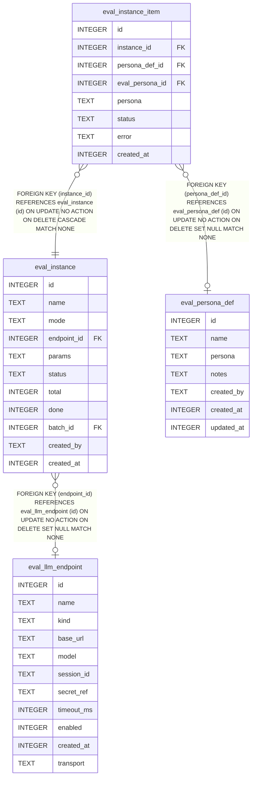

{/* Generated by bun run db:erd (product/packages/db/scripts/generate-erd.mjs) — do not edit. */}

Owned by `plugins/eval-persona`.

## ER diagram

Mermaid source: [`schema.mmd`](./schema.mmd)

## Tables

- [`eval_instance`](/pt-BR/docs/developers/plugins/eval-persona/reference/tables/eval_instance)
- [`eval_instance_item`](/pt-BR/docs/developers/plugins/eval-persona/reference/tables/eval_instance_item)
- [`eval_llm_endpoint`](/pt-BR/docs/developers/plugins/eval-persona/reference/tables/eval_llm_endpoint)
- [`eval_persona_def`](/pt-BR/docs/developers/plugins/eval-persona/reference/tables/eval_persona_def)
