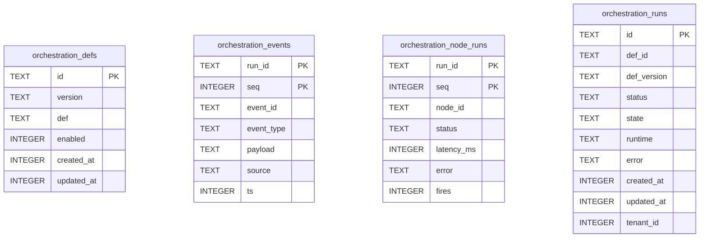

{/* Generated by bun run db:erd (product/packages/db/scripts/generate-erd.mjs) — do not edit. */}

Owned by `packages/db/src/orchestration.ts` + `packages/orchestrator`.

## ER diagram

Mermaid source: [`schema.mmd`](./schema.mmd)

## Tables

- [`orchestration_defs`](/pt-BR/docs/developers/plugins/orchestrator/reference/tables/orchestration_defs)
- [`orchestration_events`](/pt-BR/docs/developers/plugins/orchestrator/reference/tables/orchestration_events)
- [`orchestration_node_runs`](/pt-BR/docs/developers/plugins/orchestrator/reference/tables/orchestration_node_runs)
- [`orchestration_runs`](/pt-BR/docs/developers/plugins/orchestrator/reference/tables/orchestration_runs)
