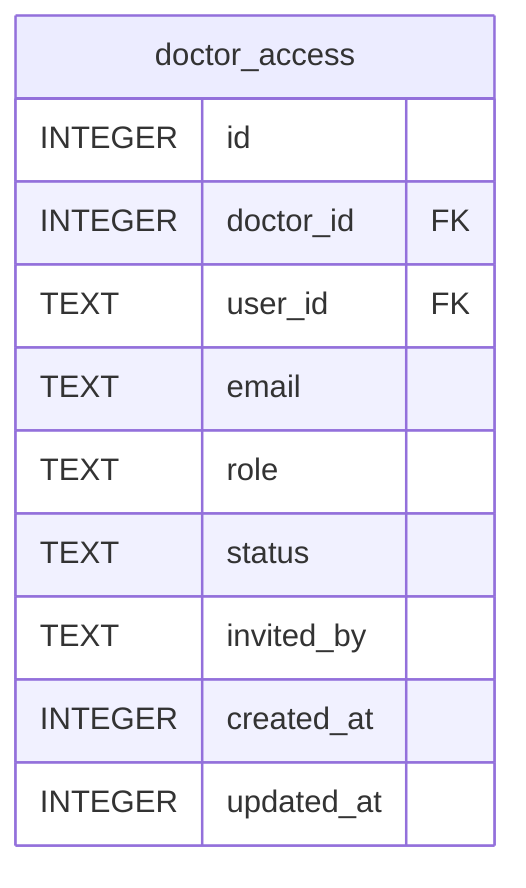

{/* Generated by bun run db:erd (product/packages/db/scripts/generate-erd.mjs) — do not edit. */}

Owned by `plugins/secretaries`.

## ER diagram

Mermaid source: [`schema.mmd`](./schema.mmd)

## Tables

- [`doctor_access`](/pt-BR/docs/developers/plugins/secretaries/reference/tables/doctor_access)
