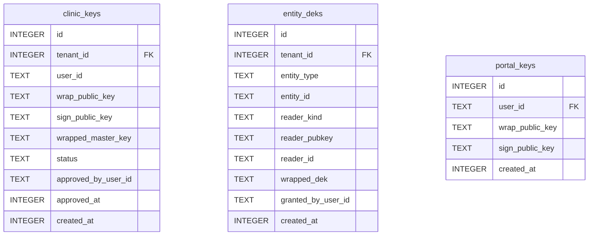

{/* Generated by bun run db:erd (product/packages/db/scripts/generate-erd.mjs) — do not edit. */}

Owned by `plugins/vault`.

## ER diagram

Mermaid source: [`schema.mmd`](./schema.mmd)

## Tables

- [`clinic_keys`](/pt-BR/docs/developers/plugins/vault/reference/tables/clinic_keys)
- [`entity_deks`](/pt-BR/docs/developers/plugins/vault/reference/tables/entity_deks)
- [`portal_keys`](/pt-BR/docs/developers/plugins/vault/reference/tables/portal_keys)
